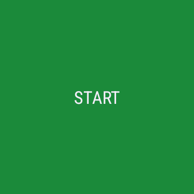
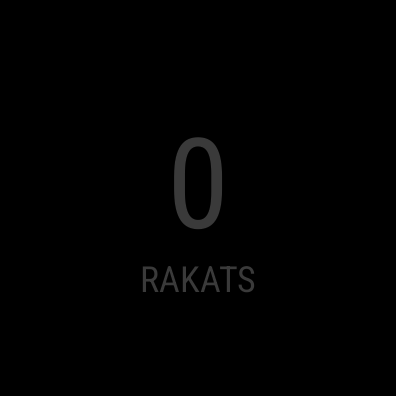
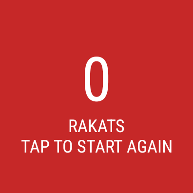
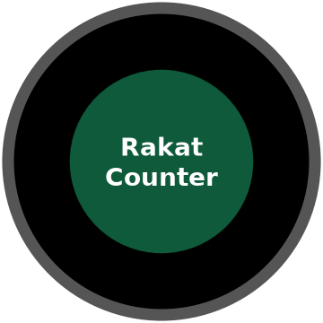
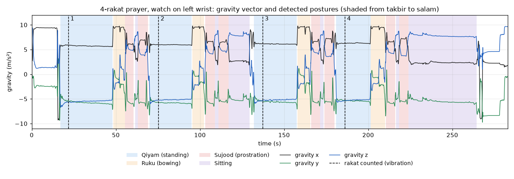

<p align="center"></p>

<h1 align="center">Rakat Counter</h1>

<p align="center">A Wear OS app for Galaxy Watch4 and newer that counts the rakats of your prayer with the watch's motion sensors.</p>

You start it before the takbir and forget about it. The watch follows the posture of your left wrist (standing, bowing, prostration, sitting), and each time you stand up after sujood it gives one short vibration. When you finish, a long press shows how many rakats you prayed.

| Start | Counting | Finished | Tile |
|:---:|:---:|:---:|:---:|
|  |  |  |  |

Screenshots from a Galaxy Watch FE (the tile image is a mockup). Store screenshots for all four languages are in `docs/play/shots/`.

## Features

- Counts rakats live on the watch, no phone needed.
- One short vibration at the start of each new rakat, so you can feel the count without looking.
- Dim gray number on a black screen while counting, so the display does not distract you.
- Long press to stop, so an accidental touch during sujood does not end the session.
- A tile on the watch face carousel to open the app with one tap.
- Debug builds (the ones `install.sh` installs) record every session as a CSV file on the watch, for later analysis and tuning. The Play Store build records nothing and needs no permissions.
- English by default, Turkish, Arabic and Indonesian picked automatically from the watch language.
- No internet permission and app backup is disabled. Nothing leaves the watch.

## How it works

The app reads the Android gravity sensor, a 3-axis vector that shows which way "down" is relative to the watch. With the watch on the **left wrist**, each posture of the prayer puts that vector in a clearly different place:

| Posture | Typical gravity (x, y, z) m/s² | Rule |
|---|---|---|
| Qiyam (standing, hands folded) | ( 5.8, -5.6, -5.3) | z < -3 and 4 < x < 8 |
| Ruku (bowing, arm down) | ( 9.5, -1.0, -1.5) | x > 8.5 |
| Sujood (prostration) | ( 6.5, -5.8, 4.5) | z > 2 and x > 5 |
| Sitting (hand on knee) | ( 2.3, -5.7, 7.6) | z > 5 and x < 4.5 |

The rules are checked in this order. Anything that matches none of them is a transition.

Counting:

1. Gravity samples are averaged over 0.5 s windows, and each window gets one posture.
2. A sujood held for at least 1 s is remembered.
3. When qiyam follows a remembered sujood and lasts 5 s, that is a new rakat. The counter goes up, the watch vibrates once, and the sujood flag is cleared.
4. The first qiyam after you press START counts as rakat 1 (the flag starts set).

The 5 s wait means the vibration comes a few seconds after you stand up, not at the moment you rise. Short shifts and the stand-up motion itself do not count.

Stopping is a **long press** on purpose. In sujood the wrist is close to the floor and the screen can be touched by accident, a single tap would end the session.

This is one real 4-rakat recording. Colored bands are the detected postures between takbir and salam, dashed lines are the moments the watch vibrated:



## Requirements

- Galaxy Watch4 or newer, or another watch with Wear OS 3+ (minSdk 30) and a gravity sensor.
- The watch worn on the **left wrist**. The thresholds were tuned for that, see [Calibration](#calibration).
- To build and install: Java 17+ and the Android SDK, either through Android Studio or the command-line tools with `sdkmanager "platforms;android-34" "build-tools;34.0.0"` and the licenses accepted (`sdkmanager --licenses`). `adb` (platform-tools) is also needed. The Gradle wrapper is included.

`install.sh` builds the app before installing it, so even if you only want to install, the full SDK is needed, platform-tools alone is not enough.

## Installation

```sh
git clone https://github.com/tamert/Smart-Rakat-Counter.git
cd Smart-Rakat-Counter
./install.sh          # English messages
./install.sh --tr     # Turkish messages
```

If you already know the watch's address you can pass it:

```sh
./install.sh 192.168.1.23:5555
```

The script builds the app, helps you pair and connect to the watch over wireless debugging, installs the APK and grants the `BODY_SENSORS` permission.

### Enabling developer options on the watch

1. Settings > About watch > Software information > Software version: tap **Software version** 5-7 times in a row until "Developer mode turned on" appears.
2. Settings > Developer options, turn on **ADB debugging** and **Wireless debugging**.
3. The watch and the computer must be on the same Wi-Fi network.
4. In Wireless debugging, tap **Pair new device** to see the pairing code and port. The install script asks for these. After pairing, adb usually connects by itself. If not, the script also asks for the ip:port on the main Wireless debugging screen.

Menu names can differ slightly between watch models and One UI Watch versions.

### Manual install

```sh
./gradlew assembleDebug
adb pair <watch-ip>:<pairing-port>       # once, with the code shown on the watch
adb connect <watch-ip>:<port>
adb install -r build/outputs/apk/debug/*.apk
adb shell pm grant com.tamer.rekat android.permission.BODY_SENSORS
```

If you skip the last line, the app asks for the permission on first launch. If `adb install` fails because an older build signed with another key is on the watch, remove it first with `adb uninstall com.tamer.rekat`.

## Usage

1. Open **Rakat Counter** from the app list, or add the tile: long press the watch face, swipe to the end of the tiles, tap **+** and choose Rakat Counter.
2. Tap **START** before the takbir. The screen turns black with a dim count.
3. Pray as usual. A short vibration means a new rakat was counted.
4. After the salam, **long press** the screen. It turns red and shows the total.
5. Tap again to start a new session.

The screen stays on during a session. The wake lock is held for at most one hour, after that the watch may sleep and counting can stop. The session itself only ends with a long press.

## Languages

English is the default. If the watch language is Turkish, Arabic or Indonesian, the app uses that language automatically. There is no setting inside the app.

## Release build (Google Play)

The release build listens to the gravity sensor only, writes no files and requests no permissions (`BODY_SENSORS` is declared in `src/debug/AndroidManifest.xml` only). Signing values come from `~/.gradle/gradle.properties`, never from the repo:

```
REKAT_STORE_FILE=/path/to/upload.jks
REKAT_STORE_PASSWORD=...
REKAT_KEY_ALIAS=upload
REKAT_KEY_PASSWORD=...
```

```sh
./gradlew bundleRelease   # build/outputs/bundle/release/rekat-sayaci-release.aab
```

Store texts are in [docs/play/listing.md](docs/play/listing.md), the privacy policy in [PRIVACY.md](PRIVACY.md).

## Recording and analysis

Recording is on only in debug builds. Each session writes every non-wakeup sensor of the watch at about 50 Hz to a CSV file in the app's private storage, `files/kayit_<date>_<time>.csv`. Lines are `t_ns,sensor,v0,v1,...`, header lines start with `#`, and each counted rakat is written as `# rekat <n> <t_ns>`.

Copy a recording to your computer:

```sh
adb shell run-as com.tamer.rekat ls files
mkdir -p kayitlar
adb exec-out run-as com.tamer.rekat cat files/kayit_20261123_153651.csv > kayitlar/kayit_20261123_153651.csv
```

The Python tools need numpy and matplotlib:

```sh
python3 -m venv .venv && .venv/bin/pip install numpy matplotlib
```

- `analyze.py <csv>` prints a summary of every sensor and draws one panel per sensor into a PNG next to the CSV.
- `rekat.py <csv>` uses only the gravity sensor. It prints the posture segments and the detected start, end, number of rakats, rukus and sujoods.
- `test_rekat.py` checks `rekat.py` and a Python copy of the live counter against real recordings with known rakat counts.

The recordings used by `test_rekat.py` (the `kayitlar/` folder) are personal and not in this repository, so the test will not run as is. Record your own prayers and adjust the expected values.

## Calibration

The thresholds are for the watch on the left wrist and come from one person's recordings. A different wrist, a loose strap or a different way of placing the hands can move the gravity vector enough to break detection.

To tune them:

1. Record a few prayers whose rakat count you know.
2. Run `rekat.py` and `analyze.py` on them and look at where x, y and z settle in each posture.
3. Change the posture rules in `durus()` in `rekat.py` until the results match.
4. Make the same change in `MainActivity.durus` (`src/main/java/com/tamer/rekat/MainActivity.kt`). The two must stay identical, otherwise the analysis and the watch disagree.

The live counting loop (0.5 s window, 1 s sujood, 5 s qiyam) is `MainActivity.say()`. Its Python copy is in `test_rekat.py`, so if you change the loop on the watch, update that copy too. The `MIN_SURE` segment filter in `rekat.py` is a separate thing used only by the offline analysis.

## Limitations and privacy

- Tested on a Galaxy Watch4 with the watch on the left wrist, by one person. Other bodies and habits may need calibration.
- Counting follows the qiyam after a sujood, so it does not tell you which part of a rakat you are in, and it can miss or add a rakat if a posture is unusually short or the wrist is held differently.
- A session must be started and stopped by hand.
- The app has no internet permission. Recordings stay in the app's private storage on the watch and can only be read with `adb` as shown above. Uninstalling the app deletes them.

## License

MIT. See [LICENSE](LICENSE).
